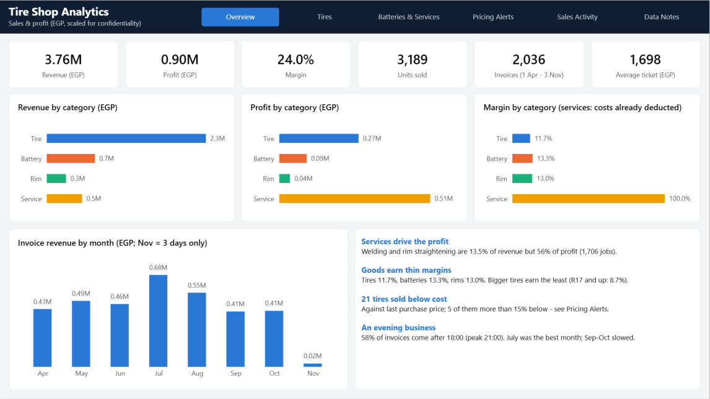
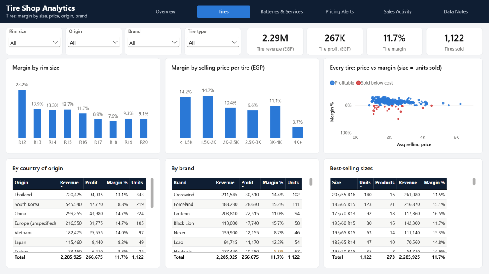
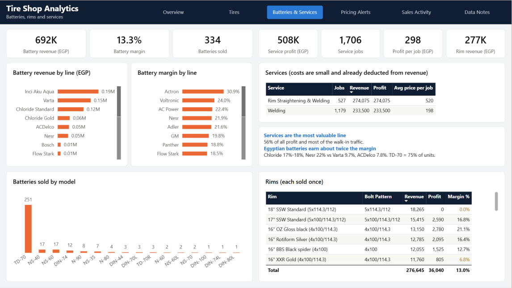
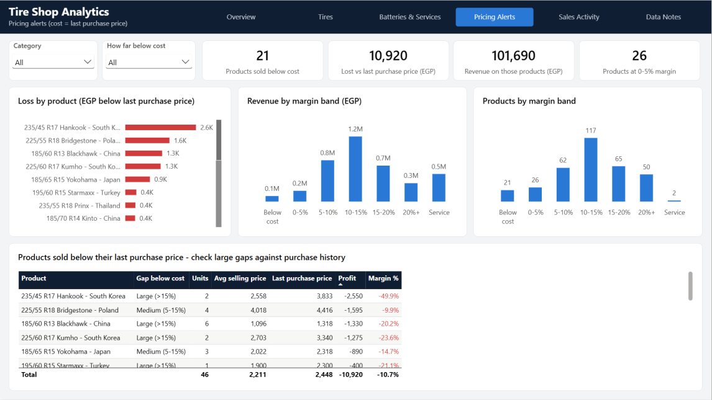
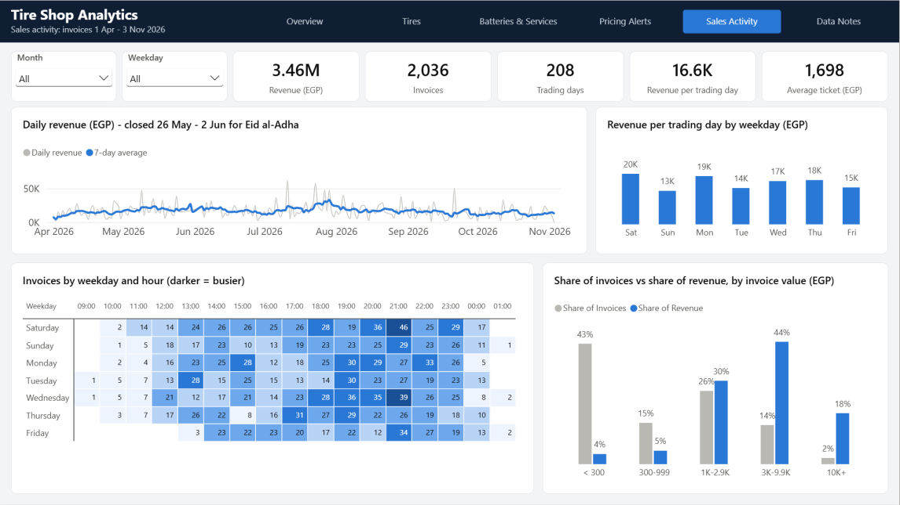
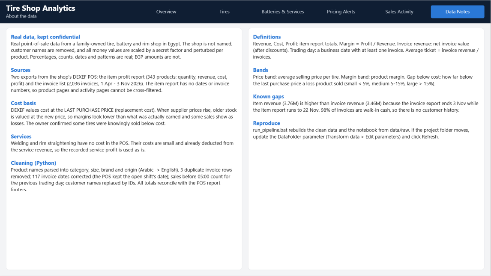

# Tire Shop Sales & Profit Analytics

**End-to-end analytics on real point-of-sale data from a family-owned tire, battery and rim shop in Egypt** - Python cleaning,
exploratory analysis, a 6-page Power BI dashboard and business recommendations.

`Python` `pandas` `matplotlib` `Jupyter` `Power BI` `DAX` `Power Query` `TMDL / PBIR` `Data cleaning` `Data storytelling`

> **Real data, kept confidential.** The data comes from the shop's actual POS system (DEXEF). To protect the business,
> the shop is not named, customer names are removed, and **all money values are scaled by a secret factor and perturbed
> per product**. Percentages, counts, dates, times and patterns are real; absolute EGP amounts are not.



## Key findings

- **Services are the profit engine:** welding and rim straightening are 13.5% of revenue but
  **56% of profit** (1,706 jobs) - and they bring most of the walk-in traffic.
- **Goods earn thin margins:** tires 11.7%, batteries 13.3%, rims 13.0%.
- **Bigger tires earn the least:** R17 and larger earn 8.7%; re-pricing them to 11% would add
  ~2.3% of their revenue in profit.
- **Korean tires sell well at a low margin** (8.8%, Hankook 5.8%),
  while Chinese, Vietnamese and European tires earn ~14-15%.
- **21 tires were sold below their last purchase price** - 5 of them by more than 15%.
- **Egyptian batteries earn about twice the margin** of Varta / ACDelco; one size (TD-70) is 75% of battery sales.
- **An evening business:** 58% of invoices come after 18:00, peaking at 21:00;
  Saturday and Monday are the best days.

Full write-up: [docs/insights_and_recommendations.md](docs/insights_and_recommendations.md) ·
Page-by-page dashboard guide: [docs/Dashboard_Guide.pdf](docs/Dashboard_Guide.pdf)

## Dashboard (Power BI)

Open **`dashboard/Tire Shop Sales Dashboard.pbix`** in Power BI Desktop - the data is embedded, no setup needed.

| Tires | Batteries & Services |
|---|---|
|  |  |
| **Pricing Alerts** | **Sales Activity** |
|  |  |
| **Data Notes** | |
|  | |

- **Model:** star schema (Products, Product Sales, Invoices, Calendar), 2 relationships, 30 DAX measures,
  sort-by columns, marked date table, a weekday x hour heat map driven by a DAX colour measure.
- **Design:** fixed colour per category, colour-blind-safe palette, every chart labelled; red is reserved for below-cost sales.
- The dashboard is also stored as a **PBIP project** (TMDL + PBIR JSON) generated and validated by
  `tools/dashboard/build_pbip.py` - every visual checked against Microsoft's report schemas.

## What I did

| Step | Work | Output |
|---|---|---|
| 1. Understand | Profiled two POS exports: an item profit report (343 products) and an invoice list (2,036 invoices) | `docs/cleaning_report.md` |
| 2. Clean (Python) | Parsed free-text Arabic product names into category, tire size, brand and origin; rebuilt invoice timestamps; removed duplicates; anonymised customers; **21 automated checks** reconcile every total with the POS footers | `cleaning/`, `data/clean/` |
| 3. Explore | 7 business questions, 13 charts, written findings | `eda/tire_shop_eda.ipynb` |
| 4. Model & dashboard | Power BI star schema, DAX measures, 6 report pages | `dashboard/` |
| 5. Validate | Schema validation, field-reference checks, expected value for every visual | `docs/qa_checklist.md` |
| 6. Recommend | Prioritised, quantified recommendations for the owner | `docs/insights_and_recommendations.md` |

### Data problems solved

- **Product master in free Arabic text.** `15-65-185 كروس ويند اوروبي` becomes tire size **185/65 R15**, brand
  **Crosswind**, origin **Europe** - plus rim bolt patterns (`4x100/114.3`), battery models (`TD-70`) and 20+ spelling variants.
- **Wrong invoice dates.** The POS stamps a sale with the date of the *open shift*, not the real day. Because invoice numbers
  are sequential, 117 timestamps were rebuilt from the sequence, with a guard that stops one bad clock time from
  shifting hundreds of later invoices.
- **Cost basis.** The POS values cost at the *last purchase price*, so "losses" are split by how far below cost they sold
  (small / medium / large) to separate pricing mistakes from supplier price increases.

## Repository structure

```
data/raw/          confidential copies of the two POS exports (identity removed, money scaled)
data/clean/        star-schema CSVs produced by the cleaning script
cleaning/          clean_data.py (pipeline + 21 validation checks), mappings.py (Arabic -> English)
eda/               tire_shop_eda.ipynb (+ HTML) and 13 charts
dashboard/         Tire Shop Sales Dashboard.pbix + PBIP project (TMDL model, PBIR report)
docs/              insights & recommendations, dashboard guide (PDF), data dictionary, QA checklist, cleaning report
tools/             facts.py (all numbers quoted in the docs), notebook / dashboard / docs builders
run_pipeline.bat   rebuild everything from data/raw
```

## How to run

```bash
pip install -r requirements.txt
python cleaning/clean_data.py      # data/raw -> data/clean (+ docs/cleaning_report.md)
python tools/build_notebook.py     # runs the analysis notebook
```

Or double-click **`run_pipeline.bat`** (Windows). Open the `.pbix` in Power BI Desktop; to load data from your own
clone, open the `.pbip`, set **Transform data > Edit parameters > DataFolder** to your `data\clean\` path and click Refresh.

## Confidentiality method

1. Shop name, address, tax and commercial-register numbers, logo and file metadata removed from the POS exports.
2. Customer names replaced (`Customer 01`...), then anonymised again to IDs in the clean data.
3. Every money value multiplied by one secret factor (kept offline) and rounded; each product's cost changed by a
   further random amount, so real purchase prices cannot be recovered. No product's profit sign was changed.

---
**Abdallah Mohammed** - Data Analyst · [GitHub](https://github.com/abdallahelarabyy)
